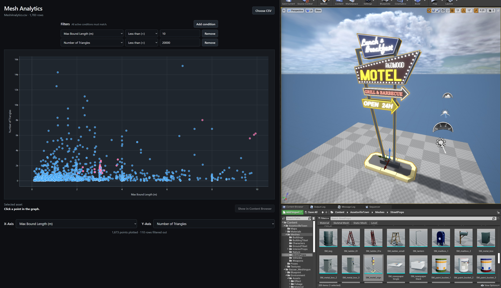

# Mesh Analytics

Mesh Analytics is an Unreal Editor tool for inspecting Static Mesh and Skeletal Mesh assets across selected Content Browser folders. It gathers useful optimization data, saves the results as a JSON file, and opens an interactive report in your default browser.

The report can help you find assets with high triangle counts, missing or excessive LODs, expensive collision, large physics data, too many material slots, oversized textures, or unusual dimensions. You can filter the results, compare any two numeric metrics on a scatter plot, and click a plotted asset to see its details, including the materials and textures it uses, or select it in the Unreal Editor Content Browser.

[Read More](https://github.com/proceduralit/AssetAnalytics_UEPlugin/wiki/Mesh-Analytics)